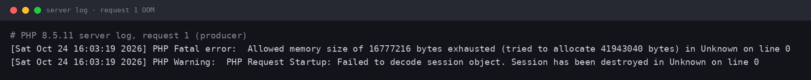
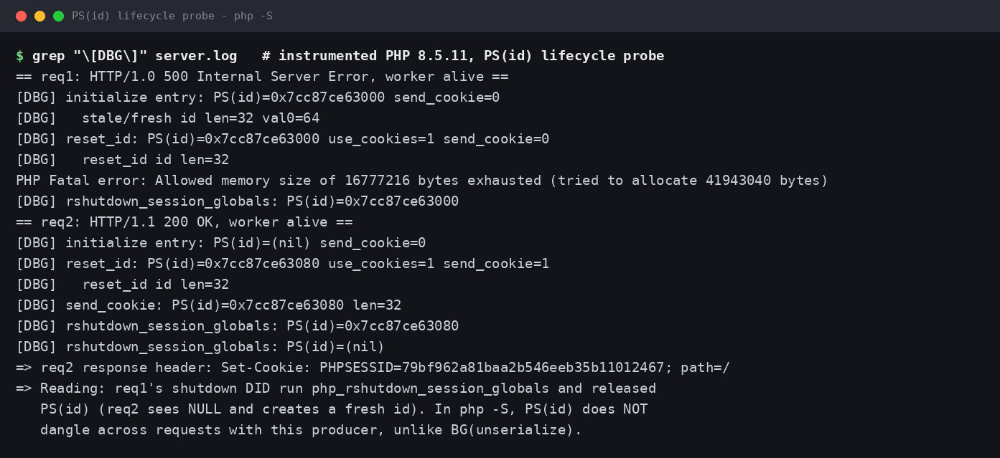

# PHP2Shell 漏洞复现报告

**CVE-2026-109618 / CVE-2026-109619（PHP 核心远程代码执行漏洞）**

| 项目 | 内容 |
|---|---|
| 披露日期 | 2026 年 10 月 21 日（紧急发布，较原定 10 月 22 日提前一天） |
| 漏洞别名 | PHP2Shell |
| 严重程度 | CVSS v4.0 **9.2（Critical）**，PHP 项目官方评分；NVD CVSS 3.1 口径为 9.8 / 8.1 |
| 影响组件 | PHP 核心运行时（内存管理、错误处理、Session 模块、请求启动顺序） |
| 漏洞类型 | CWE-416 Use-After-Free / 内存损坏（跨请求状态污染） |
| 利用条件 | **无需鉴权、无需用户交互**，仅需能向目标发送 HTTP 请求；以 PHP worker 进程权限执行 |
| 发现方 | Calif、Wiz Research、OpenAI 三方独立发现（AI 辅助审计，含 OpenAI "Patch the Planet" 项目） |
| 在野情况 | Amazon 威胁情报称其蜜罐在 **10 月 17 日**（公开披露前）已记录到利用尝试；Zscaler 称披露 48 小时内观测到 1,156 次尝试 / 156 个 IP |
| 本报告复现结论 | ✅ 已在 PHP **8.5.11** 与 **8.4.26** 上确定性复现未授权崩溃原语（两请求触发 worker SIGSEGV）；✅ 已在修复版 **8.5.12** 上验证补丁有效；完整 RCE 链未武器化复现（原因见第 6 节） |

---

## 1. 漏洞概述

2026 年 10 月 21 日，PHP 项目发布紧急安全版本 8.2.35、8.3.36、8.4.27、8.5.12，修复两个位于 PHP 核心运行时的严重漏洞：

- **CVE-2026-109618 — RCE via OOM corruption**：请求在内存耗尽（OOM）时被 `longjmp()` 中断，处于"半初始化"状态的内部数据被请求关机（shutdown）流程当作合法数据处理，造成内存损坏。
- **CVE-2026-109619 — RCE via stale global state**：请求拥有的全局状态在其请求堆被释放后仍被全局指针引用；同一 worker 处理的**下一个请求**在正常初始化完成之前就会消费这个悬空（stale）指针。除代码执行外，该漏洞还可导致 worker 进程内存披露（密码、令牌、API key 等）。

两个漏洞的共同点：缺陷不在某个应用或框架，而在 PHP 运行时本身。只要部署对外提供 Web 请求服务，即使应用代码完全安全（甚至只有一句 "Hello World"），同样受影响。脆弱代码可追溯至 PHP 5.4.0（2012 年）。

## 2. 影响版本

| 分支 | 受影响版本 | 修复版本（2026-10-21） |
|---|---|---|
| PHP 8.5 | 8.5.0 – 8.5.11 | **8.5.12** |
| PHP 8.4 | 8.4.0 – 8.4.26 | **8.4.27** |
| PHP 8.3 | 8.3.0 – 8.3.35 | **8.3.36** |
| PHP 8.2 | 8.2.0 – 8.2.34 | **8.2.35** |
| PHP 8.1 / 8.0 / 7.4 | 全部（已 EOL，无官方版本） | 仅官方最小源码 backport，或发行版 / LTS 厂商回移包 |
| PHP ≤ 7.3 | 视为受影响 | 无修复，只能升级或隔离 |

> ⚠️ 注意：Linux 发行版常回移补丁而不变更版本号，不能只凭 `php -v` 判断是否已修复，需核对发行版安全公告。

### 各 SAPI 风险差异

| SAPI | CVE-2026-109618 | CVE-2026-109619 |
|---|---|---|
| **Apache mod_php（prefork）** | **风险最高，已验证完整 RCE**：无条件执行 request shutdown；默认内存/输入限制下、应用代码运行前即可经 HTTP 触发 | **已确认 RCE**（fatal-backtrace 路径与 session 生命周期路径） |
| **PHP-FPM** | 源码分析认为易感；startup 失败时 FPM 直接退出子进程，故尚无完整 FPM 利用被公开演示 | Session 生命周期路径已验证，但依赖合适的应用操作 |
| **FrankenPHP** | 与 mod_php 类似（无条件 shutdown），likely 易感 | 未在默认配置中确立等效入口，但不代表免疫 |
| **LiteSpeed / LSAPI** | 模型类似 FPM，应用特异性利用 likely，未验证 | 条件性候选 |
| **php-cgi** | 官方公告点名"所有提供 Web 请求的安装均有风险" | 同左 |
| **CLI / 内置服务器 `php -S`** | 官方未点名纯 CLI | 本报告用作**本地复现载体**（单 worker 保证两请求落同一进程），不代表官方对其生产风险的定级 |

两 CVE 的共同硬约束：producer 与 consumer 两个请求**必须命中同一 worker**；worker 越多成功率越低，但条件不消失。

## 3. 漏洞原理

### 3.1 共同根因：bailout 跳过清理 + 全局状态跨请求存活

常驻型 SAPI（mod_php、FPM 等）中，一个 worker 进程顺序处理多个请求。每个请求有独立的请求堆，但一批全局量（`PG(...)`、`EG(...)` 以及扩展全局量，如 Session 的 `PS(...)`、Standard 的 `BG(...)`）跨请求存活。

PHP 用 `zend_bailout()` / `longjmp()` 处理致命错误（尤其是 OOM）。`longjmp()` **没有栈展开**，会无条件跳出任意 C 上下文。如果 bailout 恰好发生在"状态已发布到全局、但尚未完全初始化 / 尚未复位"的窗口期，对应的清理代码（如 `PHP_VAR_UNSERIALIZE_DESTROY`）就被跳过；请求结束时请求堆被释放，全局指针随即悬空。而在下一个请求中，`php_request_startup()` 的早期阶段（`php_hash_environment()` 解析 POST body）就存在代码路径（multipart 解析、session upload-progress 回调、INI 诊断）会在模块 RINIT 复位这些全局量**之前**消费它们——UAF 就此形成。

### 3.2 CVE-2026-109618：OOM 损坏

失败的那次内存分配不必与被破坏的数据相关——只要在半初始化窗口内触发 OOM 即可。官方 GHSA 列出了三种在"表观未超 PHP 限制"下耗尽 `memory_limit` 的 multipart 构造策略：

1. multipart 请求**不带可用的 Content-Length**，绕过初始 `post_max_size` 检查，持续供给解码后的 body；
2. 单个 multipart part 可携带**不限量的 headers**，其在 PHP 内部的表示远大于线上传输大小；
3. **空 file 控件不计入 `max_file_uploads`**，却仍生成文件元数据数组，嵌套字段名可成倍放大数组构造开销。

修复方式：移除 OOM 路径上的 `longjmp()`，改为延迟的 soft OOM（在下一个 VM 安全点触发）加更高阈值下的 hard OOM `_exit()`，使 shutdown 阶段再也看不到无效状态。

### 3.3 CVE-2026-109619：stale 全局状态（Producer / Consumer 模型）

成立需同时具备五个条件：①某操作把请求拥有的状态存入全局（producer）；②该状态未复位，或复位后被关机阶段的非致命诊断重新填充；③请求堆释放而 worker 全局仍引用它；④同一 worker 接到下一请求；⑤下一请求在正常初始化前读 / 释放 / 分支使用该 stale 值（consumer）。

已确认的 consumer 包括：

- **INI 诊断（初始化前）**：mod_php 的 `.htaccess` / `php_value` 系列指令、FPM 前端传入的 `PHP_VALUE / PHP_ADMIN_VALUE` 在 `php_request_startup()` 之前被应用，产生 warning / notice / deprecation 即消费 stale error state。修改 `error_reporting`、使用 `@`、关闭 `display_errors` / `log_errors` 均无效，因为解引用发生在"是否上报"的判断之前。
- **Session upload progress（初始化前）**：即本报告复现的路径，详见第 4 节。
- **PHP 8.5 fatal-error backtrace**：开启 `fatal_error_backtraces` 时，致命错误把 backtrace 存入 `EG(last_fatal_error_backtrace)`，关机时总是漏复位——官方称其为"最强的已演示 case"，是 mod_php 已确认 RCE 的基础。

Wiz 另归纳了 4 个可利用原语，包括经 `PS(id)` 的远程内存披露：OOM 中断清理后 `PS(id)` 指向已释放内存，下一 multipart 请求会把 stale 指针及长度当作活的 `zend_string`，URL 编码后写进 `PHPSESSID` 响应 Cookie 回传（约 67 KB 活内存）——**应用从不调用 `session_start()` 也可触发，与应用无关**。

## 4. 复现方法（CVE-2026-109619，session upload-progress 路径）

### 4.1 复现环境

| 项 | 配置 |
|---|---|
| 操作系统 | Ubuntu 24.04.5 LTS（隔离实验虚拟机） |
| 脆弱版本 | PHP **8.5.11**（官方源码包，SHA256 校验通过）、PHP **8.4.26**（官方源码包） |
| 修复对照 | PHP **8.5.12**（官方源码包） |
| 编译选项 | 脆弱版/修复版：`./configure --disable-all --enable-session --enable-cli --without-pear`；另编译一份 8.5.11 ASan 版（`-fsanitize=address --enable-debug`）用于抓崩溃栈 |
| 服务形态 | `php -S 127.0.0.1:<随机端口>`（内置服务器，单 worker，保证两请求落同一进程，模拟常驻 worker） |
| 关键 INI | `memory_limit=16M`、`session.upload_progress.enabled=1`、`session.upload_progress.cleanup=1`、`session.upload_progress.freq=1%`、`session.upload_progress.min_freq=0`、`session.use_strict_mode=0`、`session.use_cookies=0` |
| 复现脚本 | 基于公开独立复现仓库 [santihabib/CVE-2026-109619](https://github.com/santihabib/CVE-2026-109619) 的 `poc/repro_uaf.py`，未作逻辑修改 |

### 4.2 两请求构造

两个请求均为 `multipart/form-data` POST，带三个字段：`PHPSESSID`（32 个字符的固定 session id）、`PHP_SESSION_UPLOAD_PROGRESS`（触发 upload-progress 回调）、一个任意 file part。区别只在服务端 `session.save_path` 中预置的 session 文件内容：

**请求 1（Producer，埋下 stale 状态）**

```
session 文件内容:  x|a:1048576:{i:0;i:0;...（共 1,048,576 个元素，4,194,317 字节）
```

1. upload-progress 回调在 `php_request_startup()` 内、模块 RINIT 之前运行，解码该 session；
2. `php_var_unserialize_init()` 把 `BG(unserialize)` 置为 `level=1, data=<请求堆上的 php_unserialize_data 结构>`；
3. 解码百万元素数组时 `array_init_size()` 尝试分配 41,943,040 字节，超过 `memory_limit=16M` → OOM → `zend_bailout()`；
4. bailout 跳过了配对的 `PHP_VAR_UNSERIALIZE_DESTROY`，解码以 warning 失败（请求返回 **HTTP 500**），但 `BG(unserialize)` 仍保持 `level=1` 且 `data` 指向即将随请求结束被释放的内存；
5. worker 存活，进入"已埋雷"状态。

**请求 2（Consumer，踩中悬空指针）**

```
session 文件内容:  x|i:1;（小 session——必须是小 session，否则会先再次 OOM，碰不到 stale 指针）
```

1. 同一 worker 收到请求，upload-progress 回调再次在 RINIT 之前运行；
2. `php_var_unserialize_init()` 发现 `level=1 > 0`（该设计本为支持嵌套调用），**直接复用已释放的 `data`**；
3. 解码器走到 `tmp_var()`，读取 `(*var_hash)->last_dtor`——解引用悬空指针 → **SIGSEGV，worker 进程死亡**。

> 说明：把大 session 文件预置到 `session.save_path` 是实验室捷径，用于把"启动顺序缺陷"与"攻击者如何让目标产生大 session"两个问题解耦。真实攻击中，大 session 可经应用自身的 session 写入路径形成；且 109618 的 multipart 策略与 109619 的其他 consumer（INI 诊断、fatal backtrace）并不依赖这一前提。

### 4.3 复现步骤（命令）

```bash
# 1. 编译脆弱版 PHP 8.5.11（最小配置即可）
./build.sh            # -> build/php-8.5.11/sapi/cli/php
./build.sh asan       # -> ASan 版（可选，用于抓栈）
./build.sh patched    # -> build-patched/php-8.5.12/sapi/cli/php（修复对照）

# 2. 脆弱版：两请求复现（脚本自启 php -S、预置 session、发两请求、判定崩溃）
python3 poc/repro_uaf.py
#    期望: req1 -> HTTP 500 (oom=True, alive=True)
#          req2 -> <no response>, exit=-11 (SIGSEGV), 脚本 exit 0

# 3. 修复版对照
python3 poc/repro_uaf.py --php build-patched/php-8.5.12/sapi/cli/php
#    期望: req2 -> HTTP 200 OK, worker 存活, 脚本 exit 1
```

## 5. 复现结果与证据

### 5.1 PHP 8.5.11：确定性崩溃 ✅


请求 1 返回 HTTP 500 且 OOM 标志为真、worker 存活（stale 状态已埋下）；请求 2 无响应，worker 退出码 **-11（SIGSEGV）**。多次重复运行结果一致，为确定性复现。

### 5.2 请求 1 的服务端日志：OOM 证据 ✅



日志显示解码 session 时试图分配 41,943,040 字节、撞上 16 MiB 的 `memory_limit`，随后打出 "Failed to decode session object"——正是 bailout 跳过清理、请求以失败告终但全局状态未复位的现场。

### 5.3 ASan 崩溃栈：完整对应官方机理 ✅


自下而上读：`php_request_startup`（main.c:1942）→ `php_hash_environment`（php_variables.c:794，解析 POST body）→ … → `rfc1867_post_handler`（rfc1867.c:1273）→ `php_session_rfc1867_callback` → `php_session_rfc1867_cleanup` → `php_session_initialize` → `php_session_decode` → `ps_srlzr_decode_php` → 最终在 `tmp_var`（var_unserializer.c:168）解引用悬空指针触发 SEGV（READ 访问）。

关键点：**整条链全部发生在请求启动阶段**，在应用代码执行第一行之前、在 Standard 模块 RINIT 复位 `BG(unserialize)` 之前——与 GHSA-6wmf-4rv5-p3rp 描述的根因逐帧吻合。

### 5.4 跨分支验证与修复对照 ✅


- **PHP 8.4.26**（8.4 分支修复前最后一个版本）：同样两请求 → `exit=-11`，证实漏洞跨分支存在；
- **PHP 8.5.12**（修复版）：请求 1 仍会 OOM 返回 500（`memory_limit` 本身没变），但请求 2 正常返回 **HTTP 200**、worker 存活——UAF 已被消除。

### 5.5 结果汇总

| 实验 | 版本 | 请求 1 | 请求 2 | 结论 |
|---|---|---|---|---|
| 脆弱版（普通构建） | 8.5.11 | 500，OOM，worker 存活 | 无响应，**SIGSEGV (-11)** | ✅ UAF 复现 |
| 脆弱版（ASan 构建） | 8.5.11 | 500，OOM，worker 存活 | ASan 报告 SEGV @ `tmp_var`，abort (-6) | ✅ 崩溃栈确认 |
| 脆弱版（跨分支） | 8.4.26 | 500，OOM，worker 存活 | 无响应，**SIGSEGV (-11)** | ✅ 跨分支存在 |
| 修复版对照 | 8.5.12 | 500，OOM，worker 存活 | **200 OK**，worker 存活 | ✅ 补丁有效 |

## 6. 从崩溃到 RCE 的差距（重要说明）

本报告**没有**声称复现了开箱即用的远程代码执行，原因如下，写报告时必须如实区分：

- 上述复现证明的是**未授权、确定性的 worker 崩溃原语（DoS）**，以及经堆布局控制后可升级为受控写的 UAF 原语；
- 独立复现者已验证：回收被释放内存并伪造 `zend_reference` + `HashTable`（令 `pDestructor = zif_system` 并伪造 `execute_data`），可在单 worker mod_php 靶机上把该原语推进到以 `www-data` 执行命令；但这需要逐目标适配的偏移搜索（timing oracle）、堆喷布局与地址泄漏配合，**武器化脚本与逐镜像偏移均未公开**；
- 官方与 Wiz 在 mod_php 上验证的完整 RCE、以及 FPM 的 session 生命周期路径，均为实验室逐目标成果。Rapid7 的评估是：其审阅的每个公开 PoC 都"只对特定的 OS + PHP 版本 + Web 服务器组合演示 RCE，无一具有广泛可靠性"；
- 网络上部分名为 "CVE-2026-109618-exploit" 的仓库，实际利用的是 **serialize_handler 混淆 + 对象注入**（两个目录分别用 `php_serialize` / `php` 处理器 + 应用已加载带 `__destruct` 的类），属于应用配置问题，与本次修复的 UAF 本体不是一回事；有独立验证称该链在已打补丁版本上当前置条件具备时仍可工作。引用时切勿据此得出"补丁无效"的错误结论。

## 7. 修复分析（PHP 8.5.12 源码核对）

本次实验另外从源码层面核对了补丁，关键改动有三处（ChangeLog 合并记为 Core: *"Avoid state corruption via bailout"*，对应单一加固提交 `31c0ea7d7ff1d1fccb6492e52dab544011628065`）：


1. **提前复位全局状态（针对 109619）**：`main/main.c` 的 `php_request_startup()` 中新增 `php_basic_early_rinit()`，位置在 `zend_activate()` 之后、`sapi_activate()` 之前——即任何请求数据被处理（`php_hash_environment()`）之前。其实现（`ext/standard/basic_functions.c`）把 `BG(serialize_lock)` 清零，并 `memset` 清空 `BG(serialize)` / `BG(unserialize)`，同时提前复位 URL scanner。这样任何早期 consumer 都不可能再看到上一请求遗留的 stale 状态。本报告 5.4 节的对照实验正是该改动的直接效果。
2. **upload-progress 期间的 incomplete-class 模式**：`ext/session/session.c` 在 `PS(in_rfc1867_update)` 期间启用 `incomplete_classes_only`，session 中的对象只表示为 `__PHP_Incomplete_Class`，不解析类、不调用 `__wakeup` / `__unserialize` / `__destruct`，封堵 handler 混淆类链条。
3. **OOM 处理重构（针对 109618）**：移除 OOM 路径上的 `longjmp()` bailout，改为延迟 soft OOM + 高阈值 hard OOM `_exit()`，shutdown 不再消费半初始化状态。

## 8. 修复与缓解建议

### 8.1 根本修复

**升级 PHP 运行时本身**（不只是应用）：8.2 → 8.2.35、8.3 → 8.3.36、8.4 → 8.4.27、8.5 → 8.5.12 或更高。PHP 8.1 及更早版本已 EOL、无官方修复，应迁移到受支持分支，或采用发行版 / LTS 厂商的回移包并核对公告。

### 8.2 临时缓解（不能替代升级）

针对 CVE-2026-109618（OOM）：

- 以管理方式强制 `memory_limit=-1`（FPM 池 / Apache `php_admin_value`），并清除池、目录、应用层改回有限值的设置，重启全部 worker（不完整：底层 `mmap()` 失败仍可能进入 bailout）；
- `post_max_size` 保守设置（不用上传 8M、需要上传 32M），在 Web 服务器 / 代理层限制解码后请求大小、字段数、part 数、每 part header 数与嵌套深度，覆盖无 Content-Length 的请求；不用 multipart 的应用直接在前端封禁；
- 可用容器 / cgroup `memory.max` 作可用性边界（最好每 worker 独立）；**切勿用 `RLIMIT_AS` / `RLIMIT_DATA`（如 Apache `RLimitMEM`）替代**——它们会使 `mmap()` 失败，反而触发脆弱路径。

针对 CVE-2026-109619（stale state）：

- `session.upload_progress.enabled=0`，且必须设在请求解析前生效的层级：`php.ini`、FPM 池 `php_admin_flag`、Apache `php_admin_flag`；**不要指望 `ini_set()` 或 `.user.ini`**（太晚），改后重启全部 worker。仅封堵已确认的 session 路径，代价是上传进度功能停用；
- 仅 PHP 8.5：`fatal_error_backtraces=0` 并重启（仅封堵 fatal-backtrace 路径）；
- 清除初始化前应用的、会产生诊断的无效 / 已弃用按请求 INI 设置；靠改 `error_reporting`、加 `@`、关显示 / 日志无效；
- 消除攻击者可达的致命错误与执行超时（超时同样算致命打断）；
- 兜底（牺牲性能）：FPM `pm.max_requests=1` 或频繁回收 worker，只降低成功率，不根除。

### 8.3 检测与排查

- 在隔离环境以启动级配置开启 `log_errors=On`、`error_reporting=E_ALL`，回溯日志中：脚本运行前反复出现的 warning / deprecation、关机 / 扩展清理阶段的诊断、fatal / parse / uncaught 与超时记录（但"日志无记录"不证明安全）；
- 关注在野试探的典型形态（Zscaler 观测样本）：带 `PHPSESSID`、`PHP_SESSION_UPLOAD_PROGRESS` 字段与异常大 file part 的 multipart POST；WAF 厂商（Fastly 等）已提供临时规则，可作纵深防御；
- 优先排查 10 月 17 日（最早已知利用尝试）以来面向公网的 mod_php / FPM 实例的异常 worker 崩溃与重启记录。

## 9. 附带提醒：后续漏洞 CVE-2026-115560

2026 年 10 月 23 日 PHP 又发布后续公告 **CVE-2026-115560**：同为 `session.upload_progress` 的另一 RCE 向量，但**未被 10 月 21 日的修复版本修复**。其触发条件罕见（服务端 `session.serialize_handler` 为 `php_binary` / `php_serialize`，且应用运行时用 `ini_set()` 切回 `php` 后再 `session_start()`）。官方建议同样先设 `session.upload_progress.enabled=0`，等待下个常规版本修复。**不要误以为升到 8.2.35 / 8.3.36 / 8.4.27 / 8.5.12 即对该向量免疫。**

## 10. 补充实验：内存披露变体（PS(id) 经 Set-Cookie 泄露）

除崩溃/UAF 外，公开分析（Wiz、Imperva）还记载了 CVE-2026-109619 的一个**进程内存披露**变体：rfc1867 解析在 RINIT 前初始化 Session 并把 session ID 发布到全局 `PS(id)`；若 OOM 中断清理使 `PS(id)` 悬空，下一个 multipart 请求在 Session 初始化复位前走到 upload-progress cleanup 时，会把 stale 指针及其长度当作活的 `zend_string`，经 `php_session_send_cookie()` URL 编码后写进响应的 `Set-Cookie: PHPSESSID=` 回传（约 67 KB 活内存：密码、令牌、API key、证书等）。该原语在真实攻击中的定位是**信息泄漏 / 绕过 ASLR**，为后续 RCE 提供地址。本节记录本次实验对这条路径的核查结果。

### 10.1 已确认：Cookie 下发 sink 可达

在本实验环境（php -S、PHP 8.5.11）中构造第二个请求为"只带 `PHP_SESSION_UPLOAD_PROGRESS` 字段、无 file part"的 multipart POST（无 file part 时本请求的 FILE_START 不会改写 `PS(id)`），实测响应发出了 `Set-Cookie: PHPSESSID=<新 id>; path=/`，全程应用未调用 `session_start()`。这证明 cleanup → `php_session_initialize()` → `php_session_reset_id()` → `php_session_send_cookie()` 这条下发路径真实可达，与公开机理一致。

### 10.2 阴性结果：php -S 下 PS(id) 不跨请求悬空（有探针证据）

为确认 `PS(id)` 在 req1 后的真实状态，本实验在一份 8.5.11 源码副本的 `ext/session/session.c` 中植入探针（在 `php_session_initialize`、`php_session_reset_id`、`php_session_send_cookie`、`php_rshutdown_session_globals` 四处打印 `PS(id)` 指针与长度），重编译后重跑两请求序列：



探针显示：req1 在解码大 session 时 OOM（与图 2 相同），但随后 **`php_rshutdown_session_globals` 仍然执行**，`PS(id)` 被释放并置 NULL；req2 的 initialize 入口处 `PS(id)=(nil)`，于是走"新建 id"分支——10.1 中发出的 Cookie 是新生成的 id，而非内存内容。

这解释了 `PS(id)` 与 `BG(unserialize)` 的关键不对称：后者仅由下个请求的 RINIT 复位（早期 consumer 在此之前就消费它，故悬空成立）；前者在 RSHUTDOWN 即被主动销毁，本 producer 下不跨请求存活。

### 10.3 该变体的实际成立条件（据公开文档）

- bailout 需恰好落在关机清理阶段本身（使 `php_rshutdown_session_globals` 未及释放 `PS(id)`），或 `PS(id)` 在复位后被关机阶段的非致命诊断重新填充（GHSA producer 定义之二）；
- 与 SAPI 的关机语义强相关：mod_php 的关机是无条件的，属已验证环境之列；FPM 亦有相应路径但依赖应用操作；
- php -S + 本报告的 decode-OOM producer 达不到上述条件，故本实验结论为**机理与 sink 已核实、该环境下触发条件不成立**，与公开世界"仅逐目标演示、无公开 PoC"的状态一致。

## 11. 实际攻击场景与影响分析

本节从攻击者视角说明该漏洞在真实环境中的利用方式与后果（综合官方公告、Wiz 披露与 Zscaler 在野观测）。需要先校准一点：**漏洞本身给的是"以 Web 服务用户（如 www-data）身份、未授权执行代码"**；"最高权限"在真实入侵中通常不是一步到位，而是从这个立足点出发，经凭据窃取与配置缺陷逐级取得。下文按杀伤链展开。

### 11.1 杀伤链总览

1. **侦察**：大规模扫描识别 PHP 站点与版本横幅（`X-Powered-By`、错误页指纹）；Palo Alto Networks 估计约 2,260 万个暴露实例可能受影响。
2. **试探**：发送带 `PHPSESSID`、`PHP_SESSION_UPLOAD_PROGRESS` 字段与异常 file part 的 multipart POST，观察 500/OOM、worker 崩溃重启等信号，确认目标可达（在野样本见 11.4）。
3. **信息收集（可选）**：经内存披露原语（第 10 节）带回 worker 活内存，提取指针绕过 ASLR，并直接窃取内存中的会话数据、口令、令牌、API key。
4. **代码执行**：在逐目标适配的堆布局上把 UAF 升级为 RCE（机理见第 6 节），以 www-data 身份执行任意命令——**全程不需要任何账户口令**。
5. **落地与提权**：读取应用配置窃取凭据、写入 webshell 持久化，再视环境向最高权限推进（11.3）。
6. **目标达成**：窃取/勒索数据、篡改页面、挖矿、把服务器纳入僵尸网络或作为内网跳板。

### 11.2 场景一：无任何账户，直接拿下站点（预授权 RCE）

两个漏洞均为**未授权、无需用户交互**。Wiz 的官方演示即是对 `wordpress:latest`、`drupal:latest`、`joomla:latest` 官方镜像的预授权 RCE：攻击者不需要注册、不需要口令、不需要已登录会话，仅需能向站点发送 HTTP 请求。换言之，任何能被公网访问的脆弱 PHP 站点（哪怕应用本身毫无漏洞），其第一道防线在请求到达应用代码之前就已被绕过——这也是其 CVSS 9.2 与"紧急提前发布"的由来。

### 11.3 场景二：不用口令"登录"——会话与凭据窃取

即便不追求完整 RCE，内存披露原语本身就能实现"无口令登录"：

- worker 内存中驻留着**其他用户正在使用的会话数据、Bearer 令牌、API key**；带回的约 67 KB 内存可直接用于会话劫持——冒充已登录用户（含管理员）访问后台，无需知道其口令；
- PHP 进程环境与配置中常含数据库口令、云厂商密钥、第三方服务令牌；取得后可绕过 Web 层直接登录数据库或云控制台；
- 这类窃取不触发口令错误/锁定告警，隐蔽性高于口令爆破。

### 11.4 场景三：从 www-data 到"最高权限"的现实路径

RCE 的初始权限是 Web 服务用户，并非 root。真实入侵中向最高权限的推进依赖立足点能触及的资产，典型路径（均为公开入侵报告中的常见手法）：

- **应用配置即钥匙**：读取 `wp-config.php`、`.env` 等 → 数据库完全访问 → 批量导出用户数据、植入管理员账户、在数据库层落地后门；
- **云元数据服务**：服务器若在云上，以 www-data 身份请求链路本地元数据地址可能取得实例的临时 IAM 凭据 → 接管云账户内的其他资源（对象存储、其他主机），实现从单机到云账户级的控制；
- **主机配置缺陷**：可写的 cron/systemd 任务、宽松的 sudo 规则、内核本地提权漏洞、Docker socket 暴露等，任一成立即可从 www-data 提升为 root；
- **横向移动**：内网中复用窃得的凭据与令牌，攻击数据库、代码仓库与其他业务系统；
- **持久化**：植入 webshell、计划任务或恶意 PHP 扩展，使访问在单个 worker 重启/回收后依然存活。

因此对防守方的含义是：修复窗口期内的暴露不能只按"单个 Web 服务被打"估损，应按"该主机及其可达凭据的整体沦陷"来排查（见 8.3 的日志回溯建议，且应回溯至 10 月 17 日最早已知利用尝试）。

### 11.5 在野观测到的真实利用行为

- **时间线异常**：Amazon 蜜罐在公开披露前 4 天（10 月 17 日）即记录到利用尝试，提示漏洞细节或利用方法在解禁前已在小范围内流通；披露当日（10 月 21 日）Cloudflare / watchTowr 即观测到在野尝试；
- **规模**：Zscaler 统计披露 48 小时内 1,156 次尝试、来自 156 个 IP，属典型的"CVE 公开即批量扫描"模式；
- **样本形态**：与本报告第 3 节机理一致的 multipart 构造（`PHPSESSID` + `PHP_SESSION_UPLOAD_PROGRESS` + 约 15 KB 堆喷 file part）、把 webshell 代码直接塞进 `filename=`、以对象注入字符串（如 `x|O:8:\"stdClass\":0:{}`）作 `filename=` 试探、以及 Nuclei 等扫描模板的存活探测；
- **校准**：观测到"尝试"不等于观测到"成功 RCE"；watchTowr 的转述为未见成功案例。但对已确认可达预授权崩溃/披露原语的目标，防守方应按可利用处理。

## 12. 本次复现材料清单

| 文件 | 说明 |
|---|---|
| `PHP2Shell复现报告.md` | 本报告 |
| `../assets/shot1-repro-8511-crash.png` | 图 1：8.5.11 崩溃复现终端截图 |
| `../assets/shot2-oom-server-log.png` | 图 2：请求 1 的 OOM 服务端日志 |
| `../assets/shot3-asan-trace.png` | 图 3：ASan 崩溃调用栈 |
| `../assets/shot4-compare-8426-8512.png` | 图 4：8.4.26 崩溃 vs 8.5.12 修复对照 |
| `../assets/shot5-fix-8512.png` | 图 5：8.5.12 修复代码 |
| `../assets/shot6-psid-probe.png` | 图 6：PS(id) 生命周期探针日志（第 10 节） |
| `evidence/run-8511-normal.txt` / `run-8511-asan.txt` / `run-8426.txt` / `run-8512-patched.txt` | 四次实验的原始输出（含完整服务端日志与 ASan 报告） |
| `evidence/probe-psid-log.txt` | 第 10 节探针实验的完整日志（含结论注释） |
| `leak_hunt.py` / `leak_dbg.py` | 第 10 节的变体矩阵与探针实验驱动脚本 |
| `poc-109619/` | 公开复现仓库（含 `poc/repro_uaf.py`、`build.sh`、`docs/ANALYSIS.md`） |
| `php-8.4.26/`、`php-8.5.11/`、`php-8.5.12/` | 三个版本的官方源码（用于编译与补丁核对） |

> 截图中的终端图由本地脚本把**真实命令输出**渲染而成，原始文本见 `evidence/` 目录，可逐行核对。

## 13. 参考来源

- PHP 官方公告（2026-10-21）：https://www.php.net/archive/2026.php#2026-10-21-5
- GHSA-w8hw-w9fx-j79w（CVE-2026-109618）：https://github.com/php/php-src/security/advisories/GHSA-w8hw-w9fx-j79w
- GHSA-6wmf-4rv5-p3rp（CVE-2026-109619）：https://github.com/php/php-src/security/advisories/GHSA-6wmf-4rv5-p3rp
- Wiz Research 官方披露：https://www.wiz.io/blog/php2shell-php-rce
- 独立复现与根因分析（本报告复现所基于的公开仓库，作者 Santiago Habib）：https://github.com/santihabib/CVE-2026-109619
- Rapid7 评估（公开 PoC 可靠性）：https://www.rapid7.com/blog/post/etr-cve-2026-109618-and-cve-2026-109619-critical-unauthenticated-remote-code-execution-in-php/
- Zscaler ThreatLabz 在野观测：https://www.zscaler.com/blogs/security-research/cve-2026-109618-and-cve-2026-109619-php-vulnerable-unauthenticated-rce
- Imperva 深度分析：https://www.imperva.com/blog/php2shell-vulnerability-updates/
- Salesforce 安全公告：https://www.salesforce.com/blog/what-you-need-to-know-about-the-critical-php-vulnerabilities-php2shell/
- Fastly 分析与 WAF 缓解：https://www.fastly.com/blog/critical-rce-vulnerabilities-discovered-core-php-cve-2026-109618-cve-2026-109619

---

*本报告的全部实验均在本地隔离实验环境、使用自编译的 PHP 构建完成，未对任何第三方系统进行测试。复现日期：2026 年 10 月 24 日。*
